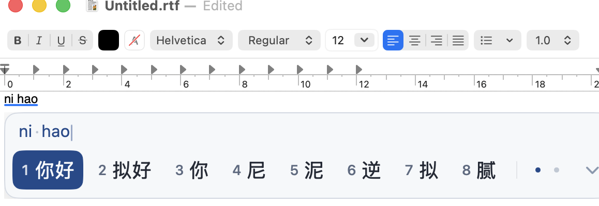
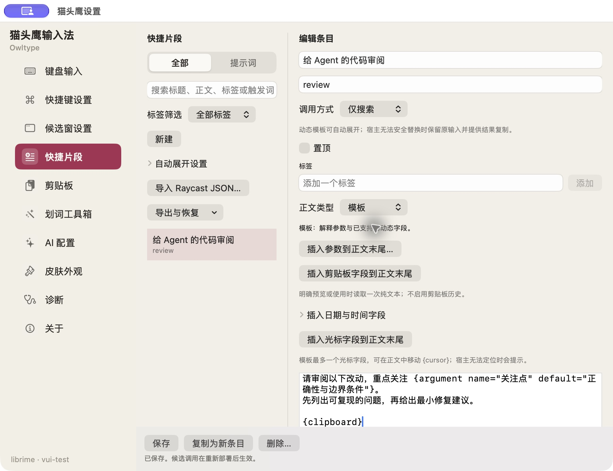
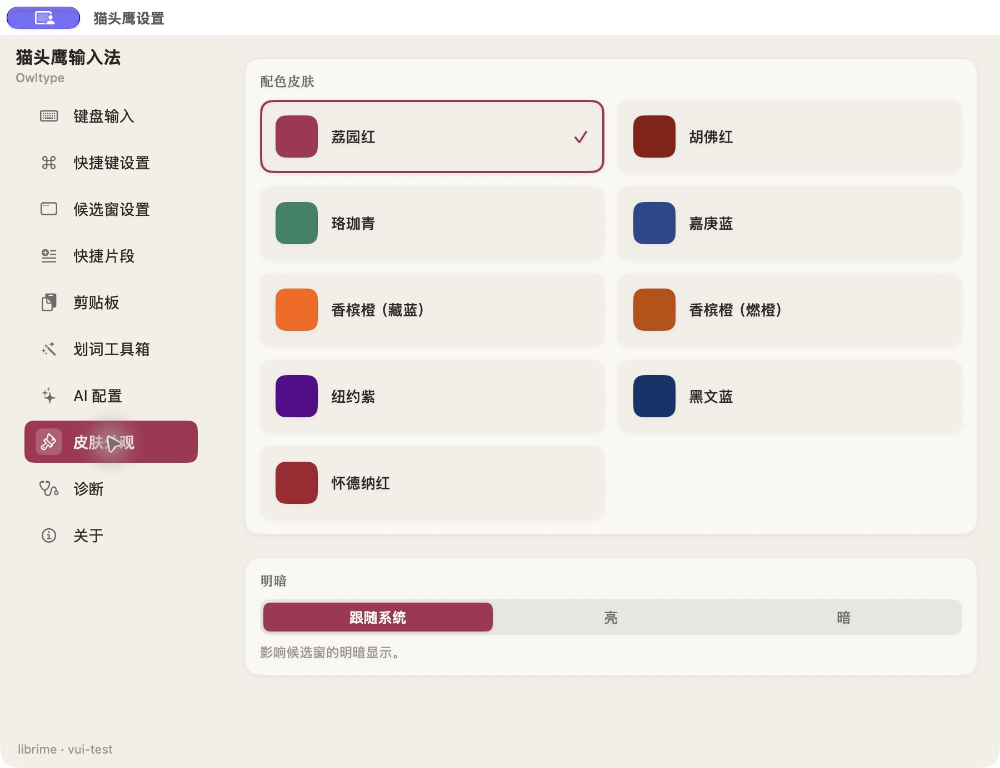
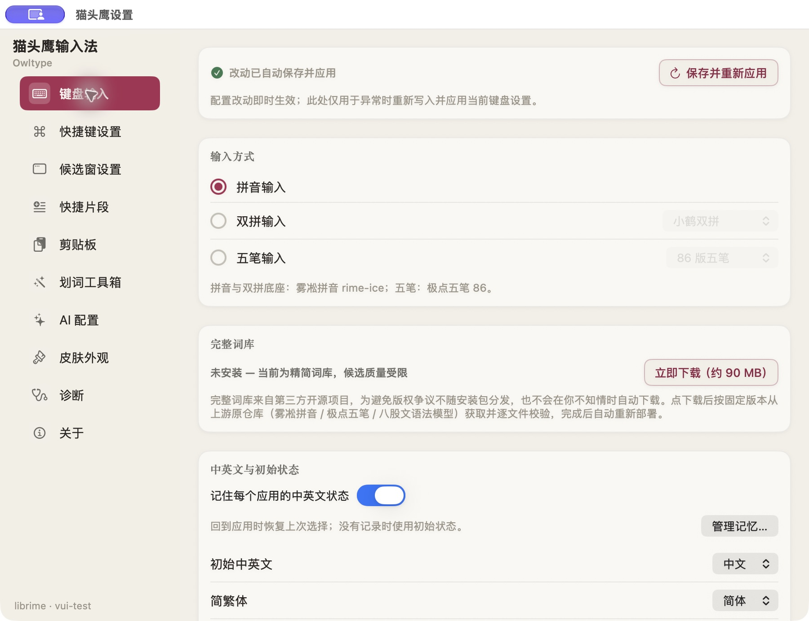

# Owltype · 猫头鹰输入法

**An open-source macOS Rust input method crafted for everyday typing and AI workflows.**

MSIME Rust Engine · Pinyin / Double Pinyin / Wubi 86 & 98 / Mixed Input · Cloud Voice ASR · AI Candidates & Jev Reranking · Prompt Snippets · 4-in-1 Installer & Repair Wizard

**深圳大学法律人工智能实训实验室 · Shenzhen University**

### [📥 Download Owltype 2.4.2 Installer DMG (Owltype-2.4.2.dmg)](https://downloads.responsay.com/owltype/releases/2.4.2/Owltype-2.4.2.dmg)

[Download & Install](#download-and-install) · [AI Workflows](#built-for-ai-workflows) · [Features](#features) · [Installer & Repair](#installer-and-recovery) · [Feedback](#project-and-feedback) · [中文](README.md)

---

## Download and install

> **System requirements**: macOS 14.0 (Sonoma) or later · Universal binary for Apple Silicon and Intel Macs · Signed with Apple Developer ID and notarized by Apple.

| Package | Use case | Immutable 2.4.2 link | Stable latest alias |
| --- | --- | --- | --- |
| **📥 Owltype Installer DMG (Recommended)** | First-time install, upgrades, repair, and full uninstall via the built-in 4-in-1 `OwltypeInstaller.app` wizard | [**Owltype-2.4.2.dmg**](https://downloads.responsay.com/owltype/releases/2.4.2/Owltype-2.4.2.dmg) | [responsay.com/owltype/Owltype.dmg](https://responsay.com/owltype/Owltype.dmg) |
| **📦 Standard PKG Installer** | Standard macOS Installer or managed deployment | [Owltype.pkg](https://downloads.responsay.com/owltype/releases/2.4.2/Owltype.pkg) | [responsay.com/owltype/Owltype.pkg](https://responsay.com/owltype/Owltype.pkg) |
| **🔄 In-place Update PKG** | Direct upgrade over an existing installation while preserving user dictionaries and settings | [Owltype-update.pkg](https://downloads.responsay.com/owltype/releases/2.4.2/Owltype-update.pkg) | [responsay.com/owltype/Owltype-update.pkg](https://responsay.com/owltype/Owltype-update.pkg) |

- **Verification and provenance**: [SHA-256 Manifest](https://downloads.responsay.com/owltype/releases/2.4.2/OWLTYPE-FILE-MANIFEST.sha256) · [SPDX SBOM](https://downloads.responsay.com/owltype/releases/2.4.2/OWLTYPE-SBOM.spdx.json) · [App Provenance](https://downloads.responsay.com/owltype/releases/2.4.2/OWLTYPE-APP-PROVENANCE.txt) · [Latest Release Metadata `latest.json`](https://downloads.responsay.com/owltype/latest.json)
- **In-app updates**: Users on `2.0.10` or later can update directly from **About → Check for Updates** (Sparkle feed: `https://downloads.responsay.com/owltype/v3/appcast.xml`).

### Quick start in 3 steps

1. Download and open [**Owltype-2.4.2.dmg**](https://downloads.responsay.com/owltype/releases/2.4.2/Owltype-2.4.2.dmg), launch **猫头鹰安装器** (`OwltypeInstaller.app`), and click **安装输入法** (Install). Approve the macOS administrator prompt when asked.
2. The installer places the bundle at `/Library/Input Methods/Owltype.app` and converges your current login session without blocking. If Owltype is not yet enabled in your input menu, follow Step 2 in the wizard to enable **猫头鹰** under **System Settings → Keyboard → Input Sources**.
3. Open Owltype Settings, select your preferred input scheme under **键盘输入** (Keyboard), and confirm local dictionary preparation. Everyday typing runs entirely on-device; configure a provider under **AI** only if you want cloud voice transcription or AI assistance.

---

## Overview

Owltype is an open-source Chinese input method for macOS built on the **MSIME Rust engine** (`owl-msime-ffi` + `owl-app-core`). Describe a task in Chinese, follow it with a `/` slash command or a `$` skill name, expand a parameterized prompt template, or hold a shortcut to dictate and polish speech into text. Owltype brings these everyday AI workflow actions directly into the input method.

Native SwiftUI candidate windows, a skin-matched floating status bar, and nine collegiate palettes keep the interface clean and responsive. Full Pinyin, Double Pinyin, Wubi 86/98, and mixed Chinese-English input run locally on your Mac, while optional cloud voice and AI features stay off until you configure and invoke them.

---

## Built for AI workflows

| Your workflow | How Owltype handles it |
| --- | --- |
| Follow Chinese text with a `/` command | Pressing `/` commits the active Chinese candidate, switches to English, and outputs an ASCII `/`. You can also switch back to a symbol menu in Settings. |
| Type a `$` skill name in terminals or agents | `Shift + 4` places ASCII `$` first in currency candidates while keeping `¥` available. |
| Summon the AI writing panel from empty composition | Type `/ai` or press `⇧K` to open the AI writing and chat panel. Typing `//` preserves literal slashes so file paths and comments are never swallowed. |
| Switch between editors, terminals, and chat apps | Per-app language memory, default-English app rules, ASCII punctuation in Chinese mode, and optional spacing between Chinese and English. |
| Reuse structured prompts across tasks | Save long prompts as snippets with `{argument}`, defaults, `{clipboard}`, date/time, and `{cursor}` placement, then preview before inserting. |
| Expand templates without opening a panel | Enable automatic expansion with `;;` triggers, or type uppercase `K` followed by the trigger for candidate-confirmed insertion. |
| Bring an existing Raycast snippet library | Import Raycast JSON exports, preview converted dynamic fields, and resolve duplicate items or trigger conflicts locally. |
| Expose templates and delivery to local agents | Built-in opt-in local Agent bridge and `owl-agent-mcp` helper verify peer code signatures over a local UNIX domain socket. |

---

## Features

### 1. MSIME Rust engine and bundled full dictionaries

- **Input schemes**: Full Pinyin, Flypy and other Double Pinyin layouts, Wubi 86 Jidian, Wubi 98, Pinyin-Wubi mixed input, English and mixed Chinese-English typing, and simplified-to-traditional conversion.
- **Bundled SQLite dictionaries and neural reranking**: Ships with pinned (`dict-v2.0.39`) SQLite dictionaries (Pinyin, Wubi 86/98, English, Emoji, and kaomoji) plus dual reranking models (`keyboard-model.bin` and `settled-model.bin`). Confirming setup prepares the dictionaries transactionally on disk while replaying your learned word frequencies and pinned candidates (`⌃⇧P`).
- **4-tab keyboard settings and candidate layout**: Keyboard settings are organized into four horizontal tabs (`方案与状态` / `拼音设置` / `五笔设置` / `标点与习惯`). Candidates default to a vertical 4-item list with Wubi code hints off by default (toggleable in Wubi settings).

### 2. Cloud voice input (ASR) and non-activating voice capsule

- **Three recording gestures and non-activating HUD**: Hold-to-talk, click-to-toggle, and spacebar hands-free lock stream 16 kHz mono WAV audio from memory while displaying a floating non-activating voice capsule that never steals focus from your active text field.
- **Five cloud ASR presets and automatic hotword injection**: Built-in presets for **xAI Grok, Alibaba Qwen ASR, Doubao ASR, OpenAI Audio, and Google Gemini Audio**. Owltype automatically extracts up to 800 UTF-8 bytes of personal hotwords from your pinned words, custom phrases, and top learned vocabulary to boost recognition accuracy.
- **Optional DeepSeek speech polishing**: Cleans filler words, fixes homophone typos, and restores punctuation with a 4.0-second hard timeout and generation-isolated callbacks, falling back to the raw transcript on timeout or network error.

### 3. AI candidates, Jev reranking, and AI writing panel

- **Generative AI Candidates (`[AI]`)**: When enabled, a 300 ms typing pause sends bounded pre-composition UTF-16 context and the current input code to append a cloud-generated candidate at the end of the first page.
- **Discriminative Jev Reranking (`[Jev]`)**: Promotes the most contextually appropriate local candidate to the first slot on typing pause without inventing out-of-vocabulary words.
- **AI writing panel and dual-candidate polishing**: Summon via `⇧K`, the status menu, or `/ai`. Includes 4 polishing styles (preserve meaning, formal, concise, expand) with side-by-side dual candidates (`[1]` / `[2]` quick commit) and 6 quick-reply templates, writing back via IMK direct insertion, Accessibility selection replacement, or clipboard fallback.
- **Kotone selection reply suggestions (v1 contract)**: Optional integration with a local Kotone service ([setup guide](docs/operations/jev-replies.md)) for multi-style reply candidates with non-blocking deadline cancellation and explicit copy.

### 4. Selected-text toolbox (8 actions)

With cloud AI enabled and Accessibility permission granted, the selection toolbar offers eight individually toggleable tools: **Ask Anything**, **Polish**, **Translate**, **Source Verification** (grouped legal, case, and literature portals plus Volcengine Ark / DeepSeek web verification), **Research Assistance**, **Prompt Optimization**, **Task Brief**, and **Publication Formatting**.

### 5. 3-card AI settings and automatic key reuse

The **AI** settings page is organized into three cards:
1. **Model Providers (Configure just one)**: Six core presets (**Qwen, Doubao, xAI Grok, OpenAI, Google Gemini, DeepSeek**) with capability badges plus custom OpenAI-compatible endpoints.
2. **Voice Input · Cloud ASR**: Five cloud ASR presets that **automatically reuse** your configured model provider API key when from the same vendor, with optional dedicated voice keys and automatic DeepSeek key reuse for speech polishing.
3. **AI Capabilities & Web Search**: Unified toggles for AI candidates, selection tools, Kotone replies, and web search verification.

| Appearance | Keyboard input |
| --- | --- |
|  |  |

---

## Installer and recovery

`Owltype-2.4.2.dmg` includes the standalone **OwltypeInstaller (`OwltypeInstaller.app`)** with a two-step onboarding wizard and a bottom **Maintenance & Uninstall** drawer offering four actions:

1. **Install / Update**: Installs `/Library/Input Methods/Owltype.app` with administrator privileges, converges the active IMK/TIS session without blocking, and guides you through enabling the input source.
2. **Repair Install (Keep dictionaries & settings)**: Reinstalls the bundle and refreshes LaunchServices, InputMethodKit, and TIS registrations while keeping all user data intact.
3. **Clean Repair (Back up data & rebuild)**: Backs up user dictionaries and preferences to `~/Library/Application Support/Owltype-Backups/<timestamp>/`, clears runtime state directories, and performs a clean install.
4. **Complete Uninstall**: Removes `/Library/Input Methods/Owltype.app`, stops running processes, and unregisters input sources, with options to keep, back up, or remove user data.

---

## Recent updates (2.4.2)

See [CHANGELOG.md](CHANGELOG.md) for the full release history.

- **2.4.2 (2026-11-08)**: 4-in-1 unified installer wizard (`OwltypeInstaller.app`) with two-step onboarding and repair/clean-repair/uninstall drawer; non-blocking file commit and IMK/TIS session convergence (#411); Wubi code hint off by default, vertical 4-candidate default, and horizontal 4-tab keyboard settings bar (#410); Kotone reply contract v1 validation (#409).
- **2.4.1 (2026-11-03)**: 3-card AI settings layout, 6 core LLM provider presets, 5 cloud Voice ASR presets with automatic API key reuse, voice callback generation isolation, and Kotone v1 cancellation and error-code alignment (#401, #402, #404).
- **2.4.0 (2026-11-03)**: Generative `[AI]` candidates and discriminative `[Jev]` reranking (#392, #395); cloud Voice ASR with non-activating capsule HUD, personal hotword injection, and DeepSeek polishing (#393, #396, #398); `/ai` writing panel with dual-candidate multi-style polishing (#394, #397).

---

## Privacy boundary

- **Everyday typing stays on-device**: Keystrokes, composition, candidate ranking, dictionary preparation, and snippet expansion run locally without uploading your typing data.
- **Cloud AI and voice are off by default**: Network requests occur only when you explicitly trigger voice recording, a selection action, or the AI writing panel, or when you separately enable opt-in AI Candidates.
- **Strict context bounds**: Requests include only the text or prompt you submit (or bounded pre-composition UTF-16 context and local hotwords when AI Candidates or Voice ASR is active). Owltype never captures screenshots, unrelated windows, or browsing history.
- **API keys live in macOS Keychain**: Secrets are stored in the system Keychain, never in plain-text preference files.

See [PRIVACY.md](PRIVACY.md) and [SECURITY.md](SECURITY.md) for details.

---

## Project and feedback

Developed and maintained by **Shenzhen University Legal AI Training Lab (深圳大学法律人工智能实训实验室)**.

- **Installer downloads**: [Website & Downloads](https://responsay.com/owltype/) · [Direct DMG Download (2.4.2)](https://downloads.responsay.com/owltype/releases/2.4.2/Owltype-2.4.2.dmg) · [Direct PKG Download (2.4.2)](https://downloads.responsay.com/owltype/releases/2.4.2/Owltype.pkg)
- **Issues & testing feedback**: [GitHub Issues](https://github.com/semantic-craft/owltype-macos/issues). When reporting an issue, please include your Owltype version (for example, `2.4.2`), macOS version, chip architecture, host application, and steps to reproduce.
- **Progress page**: [Alignment & Delivery Progress](progress/index.html)
- **Windows edition**: [semantic-craft/owltype-win](https://github.com/semantic-craft/owltype-win) (maintained independently).

---

## Provenance and license

Licensed under **GPL-3.0**; see [LICENSE.txt](LICENSE.txt).

Owltype's macOS frontend originally derived from [RIME Squirrel](https://github.com/rime/squirrel) and [librime](https://github.com/rime/librime). Starting in `2.1.0`, the input core uses the [Metasequoia IME (MSIME)](https://github.com/metasequoiaime/msime) Rust engine (currently pinned to engine `macos-v0.55.0` and dictionary release `dict-v2.0.39`), and shipped builds no longer bundle or link `librime`.

See [PROVENANCE.md](PROVENANCE.md) and [THIRD_PARTY_NOTICES.md](THIRD_PARTY_NOTICES.md) for complete lineage and third-party license notices.
