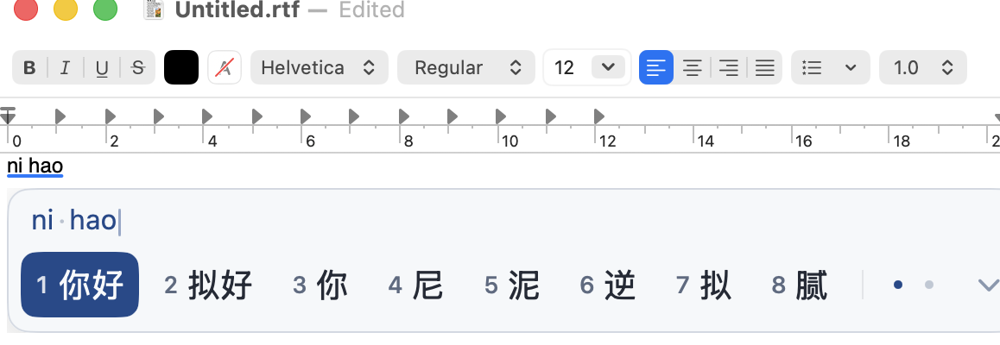
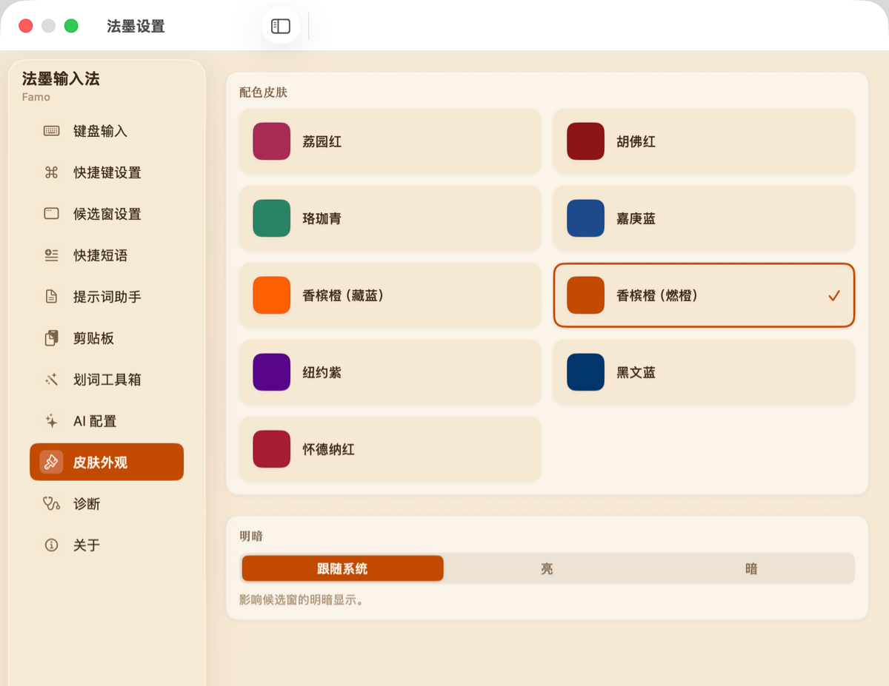
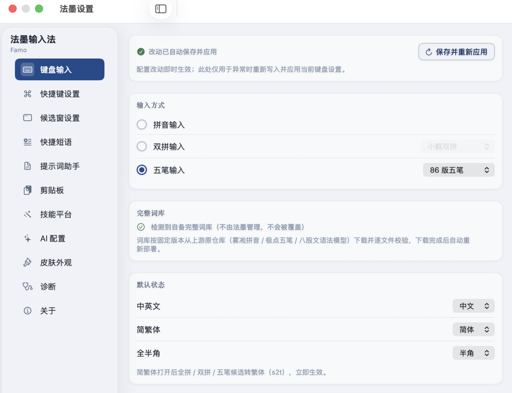

<div align="center">


# 猫头鹰输入法 · Owltype

**本地输入，顺手接入 AI。**

拼音 · 双拼 · 五笔 · 划词工具箱

**深圳大学法律人工智能实训实验室**

[](https://responsay.com/owltype/)
[](#快速开始)
[](LICENSE.txt)

[下载与安装](#快速开始) · [功能](#功能) · [最近更新](#最近更新) · [界面](#界面) · [项目与反馈](#项目与反馈)

[项目主页](https://responsay.com/owltype/) · [English](README.en.md)

</div>

猫头鹰是面向 macOS 的中文输入法。用熟悉的拼音或五笔写作，在需要时选中文字，调用润色、翻译、来源核验等工具。输入引擎基于 Rime，候选窗与设置使用原生 SwiftUI；日常输入在本机完成，可选云端 AI 由你配置并明确触发。



## 最近更新

**2.0.12 · 本仓库版本**

- **设置生效流程**：集中保存、编译与会话刷新，保留输入中的组字。
- **划词改写**：统一确认、取消和回填流程，取消后的结果不会继续预览或回填。
- **快捷片段筛选**：改用主题适配的中性底色与选中块，保留「全部／提示词」切换。

**2.0.11**

- **拼音中英混输**：修复完整词库下载或升级后，英文及中英混合候选通道没有接入的问题。
- **按应用记忆中英文**：返回应用时恢复上次选择，可管理和清除单个应用的记忆。
- **候选词置顶**：完整全拼候选支持置顶与取消，默认快捷键为 Control Shift P，并提供右键入口。
- **引导真实试打**：在原生输入框中完成「你好，猫头鹰」，核验组字与提交；粘贴不计入。
- **安装与介绍**：安装器选择本机实际可用的系统英文键盘；关于页只保留实验室署名，更新中英文项目介绍。

<details>
<summary>验收范围与上一版更新</summary>

中英混输及快捷置顶已有 TextEdit 实测；右键菜单、跨应用 Shift 切换和完整引导试打尚未完成实机验收。功能逻辑通过原生控制器与真实 Rime 集成测试，详见[设计与验收记录](docs/input-habits-design.md)。

**2.0.10（2026-10-01）** 新增 MiniMax M3.1 档案与国内站订阅搜索，并恢复更新通道。2.0.9 及更早版本需要手动安装一次 2.0.10 或更新版本，之后使用 App 内更新。

</details>

## 功能

### ⌨️ 用熟悉的方式输入

全拼、小鹤双拼、极点五笔 86，以及简入繁出。候选数量、字体、横竖排、中英文初始状态和应用初始英文规则，都能在「键盘输入」与「候选窗设置」中调整。Rime 在本机维护用户词频与学习数据。

App 内置可独立启动的引擎与基础种子词库；完整词库通过应用从上游下载。首次下载需要网络，下载后的日常输入在本地运行。

### ✨ 选中文字，就地处理

「划词工具箱」提供八项功能，可分别启用。需要先开启云端 AI、配置供应商，并为读取选区授予所需的系统权限。

| 功能 | 用途 |
| --- | --- |
| 任意提问 | 围绕选中文字下指令、追问；配置搜索后可先检索再作答。 |
| 润色 | 改善表达，在预览后决定是否替换原文。 |
| 翻译 | 翻译选中的文本。 |
| 来源核验 | 从选区提取法条、案例、文献等线索，提供来源与检索入口。 |
| 辅助检索 | 整理检索思路、关键词与查询线索。 |
| 提示词优化 | 将提示词整理成更清楚的目标、约束与结构。 |
| 任务书 | 将模糊需求整理为可执行任务，标出缺失信息。 |
| 规范排版 | 整理中文空格、标点与段落，在预览后确认替换。 |

来源核验提供法规、案例、文献等分组入口，包括国家法律法规数据库、北大法宝、裁判文书网、人民法院案例库、知网等。检索入口与 AI 回答供你查阅原文，不等于已经取得数据库全文或完成事实核验。

### 🔌 模型与搜索分别配置

内置阿里云百炼、豆包、MiMo、DeepSeek、MiniMax 等供应商预设，也可配置 OpenAI 兼容服务。按账户填写端点、模型与密钥，并通过连通性测试检查配置。

独立搜索可以搭配作答模型使用，不要求两者来自同一家服务商。MiniMax 国内站订阅搜索需要匹配的订阅 Key；模型调用、独立搜索与来源核验的能力分别判断。M3.1 使用可调思考深度，不能关闭思考。

### 📋 常用内容随手可取

「快捷片段」、剪贴板、表情与符号面板，让常用内容少打几遍。常用入口的快捷键集中在「快捷键设置」，不必修改配置文件。

### 🎨 原生设置与学院配色

九套学院风配色，支持浅色、深色与跟随系统。字体、布局、候选样式和动画可调整；皮肤选择即时生效。设置中还提供词库管理、同步目录、诊断与维护入口。

## 快速开始

**macOS 14 及以上 · Apple Silicon / Intel**

1. 从[官网下载安装器 DMG](https://responsay.com/owltype/Owltype.dmg)，打开其中的「猫头鹰安装器」，点击「安装」。macOS 可能请求管理员授权。
2. 若系统询问是否允许启用输入法，选择允许；随后在系统输入法菜单中选择「猫头鹰」。若未出现，检查「系统设置 → 键盘 → 输入法」。
3. 在猫头鹰设置的「键盘输入」中选择方案，按引导准备词库，然后在新打开的文本应用中试打。
4. 需要 AI 时，再到「AI 配置」添加供应商，在「划词工具箱」启用所需功能。只用普通输入法无需配置模型。

**安装后打不出字？** 先重新打开宿主应用。仍不可用时，按安装器提示注销并重新登录一次。不同宿主的输入法连接刷新行为有差异，不承诺所有安装或升级都无需注销。

**更新：** 2.0.10 起在「关于 → 检查更新」获取后续版本，更新源为 `https://downloads.responsay.com/owltype/v3/appcast.xml`。旧版需先手动安装一次 2.0.10 或更新版本。[直接下载更新包](https://responsay.com/owltype/Owltype-update.pkg)。

**卸载：** 打开「猫头鹰安装器」选择「卸载」。卸载会清理猫头鹰的用户数据；需要保留个人词库或配置时先备份。

## 界面

以下为仓库现有界面截图，具体控件以安装版本为准。

| 皮肤外观 | 键盘输入 |
| --- | --- |
|  |  |

<details>
<summary>查看另一套候选窗配色</summary>


</details>

## 隐私边界

- **输入留在本机**：按键、组字、候选生成与词库处理不自动上传。
- **云端 AI 默认关闭**：开启后，也只在你明确触发功能时请求模型或搜索服务。
- **只处理明确提交的内容**：请求可包含主动提交的问题、明确选中的文本及当前对话历史；不自动附带屏幕、窗口、浏览器信息、选区之外的正文或光标前后文本。
- **密钥保存在 Keychain**：不写入普通配置文件。更新与词库下载属于网络请求，不携带输入内容。

详见 [PRIVACY.md](PRIVACY.md)。安全问题请按 [SECURITY.md](SECURITY.md) 私下报告。

## 项目与反馈

**深圳大学法律人工智能实训实验室**。

- [项目主页与公开下载](https://responsay.com/owltype/) · [每版对应源码](https://responsay.com/owltype/source.tar.gz)
- [问题与建议](https://github.com/semantic-craft/owltype-macos/issues)：当前开发仓库为私有，有仓库权限的协作者可提交 Issue。请说明版本、macOS 版本、宿主应用与复现步骤。
- [Windows 版](https://github.com/semantic-craft/owltype-win)：独立维护，版本、功能与发布资产不与 macOS 版自动同步。

GitHub 是 macOS 版唯一的私有开发仓库，完整产品、工单与代码评审都在此管理；安装包、更新源与对应源码由官网分发。仓库历史从 1.4.22 源码快照开始，1.4.21 及更早公开版本已停止分发与支持。

## 从源码构建

需要 Xcode 26+ 与 macOS 14+：

```sh
git clone git@github.com:semantic-craft/owltype-macos.git
cd owltype-macos
git submodule update --init --recursive
make setup-dev
make deps
make release
```

`make setup-dev` 为当前 checkout 启用仓库自带的 pre-push 门禁。推送前会阻止密钥文件、
个人主目录绝对路径、已废弃的私有仓 remote、非 GitHub noreply 提交身份与 secret scanner 命中。
请把本仓库的 Git email 配置为 GitHub 提供的 noreply 地址；本地密钥使用 Keychain 或
被 `.gitignore` 排除的环境文件保存，不要把 AI 会话、调试日志或本机配置加入 Git。

公开构建使用清洁室词库种子（`scripts/owl-seed.sh`）：只包含授权链可审计的输入，
生成的词表限定在《通用规范汉字表》8105 字内。完整词库由 App 首启时从上游原仓库拉取，
猫头鹰自身不再分发那批数据。种子的逐项来源见构建产物里的 `OWLTYPE-SEED-SOURCES.md`。

签名、公证与打包由 `scripts/release.sh` 处理；验证完成后由
`scripts/owl_distribution.py --publish` 将完整 cohort 发布到 responsay.com。本项目没有托管
CI：合并前的门禁由开发机上的 `scripts/gate.sh` 执行，详见
[docs/operations/ci.md](docs/operations/ci.md)。

## 来源与许可

本项目以 **GPL-3.0** 发布，许可证全文见 [LICENSE.txt](LICENSE.txt)。猫头鹰是
[RIME 鼠须管（Squirrel）](https://github.com/rime/squirrel) 与
[librime](https://github.com/rime/librime) 的派生作品。基于本项目分发二进制时，必须同时提供
对应的修改源码、GPL-3.0 许可证文本与版权声明，不得作为闭源制品分发。
每个二进制版本的完整对应源码可从[官网固定入口](https://responsay.com/owltype/source.tar.gz)取得；
开发仓库保持私有不改变接收者依 GPL 获得、修改和再分发该份源码的权利。

完整来源脉络见 [PROVENANCE.md](PROVENANCE.md)，第三方组件许可见
[THIRD_PARTY_NOTICES.md](THIRD_PARTY_NOTICES.md)。

## 致谢

- [RIME / 中州韻输入法引擎](https://rime.im)——librime 与 Squirrel
- [雾凇拼音 rime-ice](https://github.com/iDvel/rime-ice)
- [极点五笔 86](https://github.com/KyleBing/rime-wubi86-jidian)
